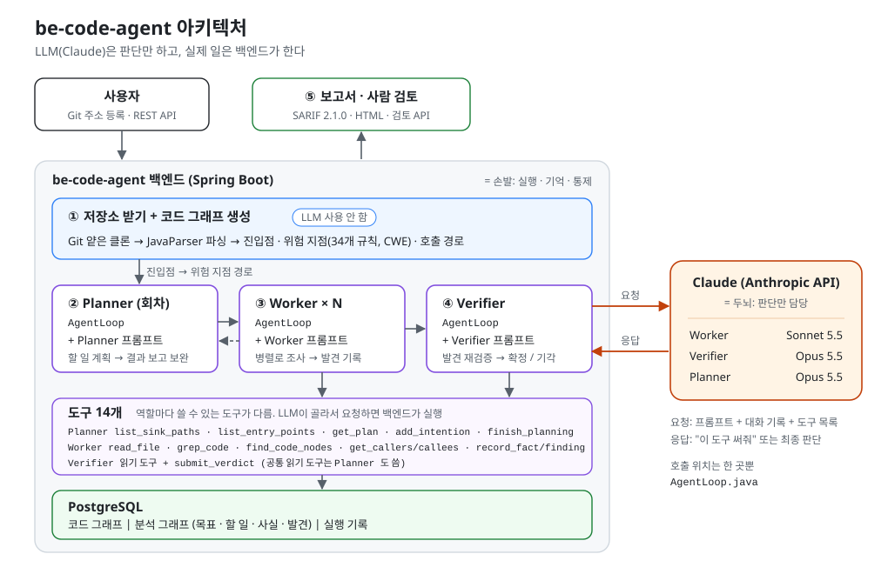
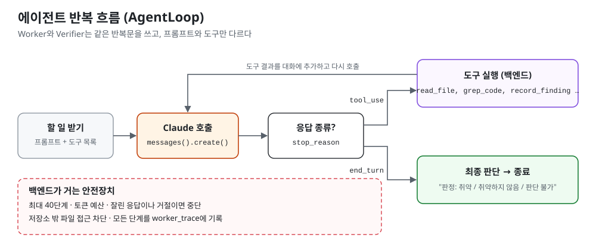

# be-code-agent

**An LLM multi-agent code security analysis system that explores source code to find security vulnerabilities**

[English](#english) · [한국어](#한국어)

<a id="english"></a>

be-code-agent statically parses a repository's source code into a **code graph**, and LLM agents work on top of it to trace "does user input reach a dangerous API?" in order to find and verify vulnerabilities.
The architecture follows the dual graph + Planner/Worker design of [ARTEX](https://github.com/Autumn-27/ARTEX), but all code is written from scratch. Where ARTEX explores a **live server**, be-code-agent explores **source code**.

> Current stage: **the Planner → Worker → Verifier agent structure is implemented.**
> - **Planner (Opus)**: looks at the code graph and decides what to investigate. Besides path investigations, it also creates tasks for missing authorization checks and security configuration reviews.
> - **Several Workers (Sonnet)**: split the tasks between them and investigate.
> - **Next Planner round**: looks at the results and adds follow-up tasks or finishes the plan. Up to 3 rounds.
> - **Verifier (Opus)**: at the end, re-checks the findings one by one.
>
> See [Progress](#progress) for details.

> Web UI: **[fe-code-agent](https://github.com/yeomyaloo/fe-code-agent)** (React). Register repositories, browse the code graph, start analyses, follow progress and the agent trace timeline, review findings and get reports from the browser.

> Chat version: **[mcp-code-agent](https://github.com/yeomyaloo/mcp-code-agent)** runs the same kind of audit from chat as a Claude Code plugin. It is not a fallback for people without an API key but a different way of working: Claude in your chat drives the audit using whatever Claude Code is logged in with (a Claude subscription or an API key), with no server or database to run.
>
> ```bash
> claude plugin marketplace add yeomyaloo/mcp-code-agent
> claude plugin install code-agent@yeomyaloo-code-agent
> ```



---

## Contents

- [Features](#features)
- [Progress](#progress)
- [Installation](#installation)
- [Configuration](#configuration)
- [Usage](#usage)
- [Development](#development)
- [System architecture](#system-architecture)
- [Directory structure](#directory-structure)
- [References](#references)
- [Built with](#built-with)
- [License](#license)
- [Disclaimer](#disclaimer)

---

## Features

### Repository registration (implemented)

- **Register by Git URL**: give the https URL of a public repository and the server shallow-clones only the latest commit into its working folder (`workspace/`). If the branch is omitted, the remote's default branch is used. The cloned branch and commit hash are recorded.
- **Sync**: fetches the latest commit again from the same URL. Refused while an analysis job is running.
- **Server protection**: so that this server cannot become a path into the internal network (SSRF), only `https` + allowed hosts (by default github.com, gitlab.com, bitbucket.org) + addresses that resolve to public IPs are accepted. The URL may not contain credentials, a port or a query.
- **Cloned code is only read**: submodules are not fetched, and symlinks that could point outside the repository are deleted. If the size limit (default 500 MB) is exceeded, the clone is deleted and registration fails. File tools check the real path once more so files outside the repository cannot be read.
- **Register a local path**: for development, a folder path on the server's disk is also accepted. On a server shared by several people, turn it off with `allow-local-path: false`.

### Code graph construction (implemented)

- **Source-only analysis, no library jars**: types are inferred from import statements and variable/field declarations, falling back to the JavaParser symbol solver. Repositories can be analyzed without building them.
- **Structure extraction**: builds the file → class → method hierarchy and inheritance links (interface method → implementing method).
- **HTTP entry point detection**: reads `@GetMapping`, `@PostMapping`, `@RequestMapping` etc. in `@RestController`/`@Controller` classes and normalizes them to the form `GET /api/users/search`. Class-level paths, multiple paths and `method = {GET, HEAD}` are handled.
- **Sink detection**: about 30 rules in 9 categories find calls to dangerous APIs, plus **IDOR candidates**: id-based access through Spring Data repositories (see the table).

  | Category | CWE | Typical APIs |
  |---|---|---|
  | SQL | CWE-89 | `Statement.execute*`, `JdbcTemplate.query*`, `EntityManager.createNativeQuery` |
  | COMMAND | CWE-78 | `Runtime.exec`, `new ProcessBuilder` |
  | PATH | CWE-22 | `new File`, `Paths.get`, `Files.read*/write*` |
  | DESERIALIZATION | CWE-502 | `ObjectInputStream.readObject`, `XStream.fromXML`, `Yaml.load` |
  | SSRF | CWE-918 | `new URL`, `RestTemplate.*` |
  | CODE_INJECTION | CWE-94 | `ScriptEngine.eval` |
  | EXPRESSION_INJECTION | CWE-917 | `SpelExpressionParser.parseExpression` |
  | JNDI | CWE-74 | `InitialContext.lookup` |
  | OPEN_REDIRECT | CWE-601 | `HttpServletResponse.sendRedirect` |
  | IDOR | CWE-639 | `findById`, `getById`, `getReferenceById`, `getOne`, `deleteById` on project interfaces that extend a Spring Data repository (`JpaRepository`, `CrudRepository`, … directly or through a project base interface). Owner-scoped queries such as `findByIdAndUser` are not flagged. These are candidates: the worker checks whether the code compares the requesting user with the data owner |

- **Entry point → sink path search**: a PostgreSQL recursive CTE extracts "which API reaches which sink through which methods". Calls through interfaces are followed too.

### Agent analysis (implemented)

- **Task (intention) creation**: choose one of two modes (`planner`).
  - `llm` (default): the **Planner agent** (default Claude Opus 5.5) creates tasks (INTENTION) in the shared task list.
    - **Round 1**: plans from the entry point → sink paths and the list of entry points. It also creates tasks for problems that have no path:
      - missing owner checks on APIs that handle data via a path variable (`{id}`) (CWE-639)
      - missing role checks on admin functions (CWE-862)
      - security configuration, hardcoded secrets
    - **Round 2 onward**: after the Workers finish all tasks, it reads their conclusions and findings and adds tasks if follow-up investigation is needed. Otherwise it ends with `finish_planning`.
    - **Ordered tasks**: linked with `depends_on` (a DEPENDS_ON edge), a task starts only after its prerequisite is done. If the prerequisite fails, the dependent task is marked failed too.
    - **Stop conditions**: it never exceeds the task limit (`maxIntentions`) or the maximum number of rounds (`planner-rounds`, default 3).
  - `paths`: mechanically creates one task per entry point → sink path, using the shortest path for each (entry point, sink) pair.
- **Planner tools**
  - 5 Planner-only tools

    | Tool | What it does |
    |---|---|
    | `list_sink_paths` | Entry point → sink paths (shortest per pair), marking paths that already have a task |
    | `list_entry_points` | All HTTP entry points (including those that reach no sink; candidates for authorization checks) |
    | `get_plan` | Shared task list: status, round created, prerequisites, Worker conclusion summary, findings |
    | `add_intention` | Add a task (instruction, optional entry point and sink, category and CWE, prerequisites). Blocks duplicates of the same path and going over the limit |
    | `finish_planning` | End planning (no next round) |

  - 6 read-only tools: `read_file`, `grep_code`, `find_code_nodes`, `get_callers`, `get_callees`, `search_worker_traces`
  - The Planner does not record facts or findings.
- **Worker agent loop**: Claude calls tools to check in the code whether "external input reaches the sink without being blocked", and leaves a verdict (vulnerable / not vulnerable / undetermined) with evidence. Every step is recorded in `worker_trace`.
- **8 Worker tools**

  | Tool | What it does |
  |---|---|
  | `read_file` | Read a repository file with line numbers (up to 400 lines per call, paths outside the repository blocked) |
  | `grep_code` | Regex code search (up to 80 matches) |
  | `find_code_nodes` | Find code graph nodes by name |
  | `get_callers` / `get_callees` | Callers / callees (interface ↔ implementation included) |
  | `search_worker_traces` | Search other Workers' traces in the same analysis job |
  | `record_fact` | Record a fact confirmed in the code |
  | `record_finding` | Record a vulnerability finding (evidence code location required, saved as pending verification) |

- **Stop conditions**: maximum steps per task, the analysis job's token budget, truncated responses, model refusals, context overflow. If the very first call fails (authentication error etc.), the whole job stops.
- **Finding verification (Verifier)**: after the Workers finish all tasks, a separate agent (default Claude Opus 5.5) takes each pending (`OPEN`) finding, does not trust the report, re-reads the code and gives a verdict.
  - Checks: whether the input really comes from outside, whether it is actually reachable from the entry point, whether defenses (input validation, parameter binding, authorization checks, etc.) block it, whether the severity is overstated
  - Tools: 6 read-only tools (`read_file`, `grep_code`, `find_code_nodes`, `get_callers`, `get_callees`, `search_worker_traces`) + `submit_verdict`
  - Verdicts: `CONFIRMED` (exploitable) / `REJECTED` (false positive) / `UNCERTAIN` (not enough evidence). The reasoning, the defenses checked and the re-assessed severity are stored in the finding's `props.verification`.
  - If the Verifier ends without submitting a verdict (step or budget limit, error), the finding is left as `UNCERTAIN`.
- **Parallel Workers**: several Workers (`codeagent.agent.workers`, default 3) run at the same time in one analysis job. Tasks are taken with `SELECT ... FOR UPDATE SKIP LOCKED` so the same task is never processed twice, and token usage is added atomically in the DB so Workers do not overwrite each other. If one Worker fails on its very first call (authentication error etc.), the other Workers stop too.

### Reports and human review (implemented)

- **SARIF 2.1.0 report**: the standard format read by static analysis tools such as GitHub code scanning. Contains rules per CWE, evidence code locations (the first is the primary location, the rest are related locations), severity scores (`security-severity`), verification verdicts and the analyzed commit (`versionControlProvenance`).
- **HTML report**: a single-file report you open directly in a browser. Shows counts by severity, a summary table, and for each finding the entry point, sink, attack example, evidence code, verification reasoning and human review result. All LLM-written text and code is escaped, and `Content-Security-Policy` blocks script execution.
- **Ordering and exclusion**: by severity (the Verifier's re-assessed value first) → verdict (confirmed → pending → uncertain). False positives (`REJECTED`, or marked `FALSE_POSITIVE` by a person) are left out by default and only counted (included with `includeDismissed=true`).
- **Human review**: for each finding, record `ACCEPTED` / `FALSE_POSITIVE` / `FIXED` / `WONT_FIX` (risk accepted) with a comment. The Verifier's verdict is kept as is; the review is stored separately in `props.review`. The row is locked so it does not overwrite a Verifier writing at the same time.

---

## Progress

| Step | Description | Status |
|---|---|---|
| 1 | Project skeleton, DB schema (code graph + analysis graph) | ✅ Done |
| 1-1 | Register repositories by Git URL (public repositories, shallow clone), sync, SSRF and symlink blocking | ✅ Done |
| 2 | Code graph construction (Java/Spring parsing, entry points, sinks, call edges) | ✅ Done |
| 2-1 | IDOR candidates: id-based Spring Data repository access as sinks (CWE-639) | ✅ Done |
| 3 | Code graph query API (entry points, sinks, call paths, callers/callees) | ✅ Done |
| 4 | LLM integration (Anthropic Java SDK), 8 Worker tools, Worker agent loop | ✅ Done (real API calls to be verified once an API key is registered) |
| 5 | Shared task list (`SKIP LOCKED`) and analysis job API | ✅ Done |
| 5-1 | Parallel Workers (`workers`, default 3) | ✅ Done |
| 5-2 | LLM Planner (multi-round planning, checks without paths, DEPENDS_ON ordering, cascading failures) | ✅ Done (real API calls to be verified once an API key is registered) |
| 6 | Finding verification (Verifier, false positive removal) | ✅ Done (real API calls to be verified once an API key is registered) |
| 7 | Reports (SARIF 2.1.0, HTML), human review API | ✅ Done |
| 8 | Web UI ([fe-code-agent](https://github.com/yeomyaloo/fe-code-agent), progress via 2-second polling) | ✅ Done |
| 8-1 | Real-time progress (SSE), human approval step | ⬜ Planned |
| 9 | One-click Docker Compose setup (PostgreSQL + backend + web UI), checked on GitHub Actions | ✅ Done |

---

## Installation

### Quick start with Docker (recommended)

All you need is [Docker](https://docs.docker.com/get-docker/). One command starts PostgreSQL, this backend and the web UI ([fe-code-agent](https://github.com/yeomyaloo/fe-code-agent), built straight from GitHub).

```bash
git clone https://github.com/yeomyaloo/be-code-agent.git
cd be-code-agent
cp .env.example .env          # put your ANTHROPIC_API_KEY in .env
docker compose up -d --build
```

Open **http://localhost:3000**. Stop with `docker compose down` (add `-v` to also delete the database).

| `.env` | Default | Description |
|---|---|---|
| `ANTHROPIC_API_KEY` | (empty) | Needed for agent analysis only. Registering repositories and building code graphs work without it |
| `WEB_PORT` / `API_PORT` | `3000` / `8080` | Ports, bound to `127.0.0.1` (this computer only) |
| `LOCAL_REPOS_DIR` | `./repos` | Folder mounted read-only at `/repos`. Register a local repository with the server path `/repos/<folder>` |
| `DB_PASSWORD` | `codeagent` | PostgreSQL password, used only inside the containers |
| `WEB_SOURCE` | fe-code-agent on GitHub | Web UI source. Set a local path (e.g. `../fe-code-agent`) to use your own changes |

Every push that touches the Docker setup is checked by [GitHub Actions](.github/workflows/docker-compose.yml): it runs `docker compose up`, then registers the test fixture through the web UI's proxy and builds its code graph.

The steps below are for running from source without Docker.

### Requirements

- Run Gradle with **JDK 17 or later** (the JDK 21 used for the build is downloaded automatically by the Gradle toolchain)
- **PostgreSQL 15 or later**

### 1. Prepare the database

After installing PostgreSQL, connect with `psql -U postgres` and run:

```sql
create user codeagent with password 'codeagent';
create database codeagent owner codeagent;
```

Tables are created automatically by Flyway (`src/main/resources/db/migration`) when the application starts.

### 2. Register an Anthropic API key

Only needed for agent analysis (`/analyses`). Building and querying the code graph works without a key.

1. Get an API key from the [Anthropic Console](https://console.anthropic.com).
2. Copy the sample file to create `application-local.yml`.

   ```bash
   cp src/main/resources/application-local.yml.example src/main/resources/application-local.yml
   ```

3. Put the key in `application-local.yml`.

   ```yaml
   codeagent:
     llm:
       api-key: sk-ant-...
   ```

`application-local.yml` is in `.gitignore`, so it is never pushed to git. **Do not write the key directly in `application.yml`.** See [Managing secrets](#managing-secrets) for details.

### 3. Run

```bash
./gradlew bootRun
```

In Windows PowerShell, use `.\gradlew.bat bootRun`.
The default address is `http://localhost:8080`.

---

## Configuration

The configuration file is `src/main/resources/application.yml`. It can be overridden with these environment variables.

| Environment variable | Default | Description |
|---|---|---|
| `DB_URL` | `jdbc:postgresql://localhost:5432/codeagent` | DB connection URL |
| `DB_USERNAME` | `codeagent` | DB user |
| `DB_PASSWORD` | `codeagent` | DB password |
| `ANTHROPIC_API_KEY` | (none) | Anthropic API key (`codeagent.llm.api-key`) |
| `CODEAGENT_WORKSPACE` | `./workspace` | Folder where Git repositories are cloned |
| `CODEAGENT_ALLOW_LOCAL_PATH` | `true` | Whether registering a folder path on the server's disk is allowed |

- JPA runs with `ddl-auto: validate`, so schema changes must go in a Flyway migration file (the next number, like `V5__...sql`). Migration files that have already been applied are never edited.
- Virtual threads (`spring.threads.virtual.enabled`) are enabled.

### Managing secrets

Secrets such as API keys and passwords only have a **placeholder** in `application.yml`; the real values live somewhere that is not pushed to git.

| File / location | Contents | git |
|---|---|---|
| `src/main/resources/application.yml` | Only placeholders such as `api-key: ${ANTHROPIC_API_KEY:}` | Committed |
| `src/main/resources/application-local.yml` | Real values on your own PC (read automatically at startup) | **Not committed** |
| `src/main/resources/application-local.yml.example` | Sample of the file above | Committed |
| Environment variables | Recommended for server deployments | - |

Values are read in the order `application-local.yml` → environment variables. If `application-local.yml` has `codeagent.llm.api-key`, that value is used; otherwise the `ANTHROPIC_API_KEY` environment variable is used.

`.gitignore` also excludes `.env`, certificate files such as `*.pem` and `*.key`, `application-secret.yml`, and log files.

### LLM settings

Change these under `codeagent.llm` and `codeagent.agent` in `application.yml`.

| Setting | Default | Description |
|---|---|---|
| `codeagent.llm.worker.model` | `claude-sonnet-5-5` | Model used by the Workers |
| `codeagent.llm.worker.effort` | `medium` | Worker reasoning effort (`low` / `medium` / `high` / `xhigh` / `max`) |
| `codeagent.llm.verifier.*` | `claude-opus-5-5`, `high` | Model and reasoning effort for the Verifier |
| `codeagent.llm.planner.*` | `claude-opus-5-5`, `high` | Model and reasoning effort for the Planner |
| `codeagent.llm.max-tokens` | `16000` | Maximum output tokens per response |
| `codeagent.llm.fallbacks` | `true` | If the model refuses a request through its safety classifier, the server automatically retries with another model |
| `codeagent.agent.max-steps` | `40` | Maximum number of LLM calls per task |
| `codeagent.agent.workers` | `3` | Number of Workers running at once in one analysis job. Adjust to your API rate limits (requests and tokens per minute) |
| `codeagent.agent.planner` | `llm` | Task creation mode when the request does not set one (`llm` / `paths`) |
| `codeagent.agent.planner-rounds` | `3` | Maximum number of rounds in which the Planner creates tasks |

The system prompts (`agent/PlannerPrompts.java`, `agent/WorkerPrompts.java`, `agent/VerifierPrompts.java`) are the same for every round and task, so prompt caching applies to them.

### Repository clone settings

Change these under `codeagent.workspace` in `application.yml`.

| Setting | Default | Description |
|---|---|---|
| `dir` | `./workspace` | Clone folder (excluded from git) |
| `allowed-hosts` | `github.com, gitlab.com, bitbucket.org` | Hosts allowed for cloning. Add your company Git server here to use it |
| `max-size-mb` | `500` | Repository size limit |
| `timeout-seconds` | `60` | Network connect and read timeout |
| `allow-local-path` | `true` | Allow registering a folder path on the server's disk |

Private repositories (auth tokens) are not supported yet.

---

## Usage

### 1. Register a repository to analyze

Register it by Git URL. If `name` is omitted, the repository name is used; if `branch` is omitted, the default branch is used.

```bash
curl -X POST localhost:8080/api/projects -H "Content-Type: application/json" \
     -d '{"gitUrl":"https://github.com/spring-projects/spring-petclinic"}'
```

For development you can also register a folder on the server's disk (use forward slashes (`/`) in the path).

```bash
curl -X POST localhost:8080/api/projects -H "Content-Type: application/json" \
     -d '{"name":"my-app","repoPath":"C:/path/to/my-app"}'
```

| API | Description |
|---|---|
| `POST /api/projects` | Register. Exactly one of `gitUrl` (+ `branch`) and `repoPath`. `name` and `language` (default `java`) are optional |
| `POST /api/projects/{id}/sync` | Fetch the Git repository again at the latest commit. Then call `/index` to update the code graph |

The response's `gitBranch`, `commitSha` and `syncedAt` tell you which commit is being analyzed.

### 2. Build the code graph

```bash
curl -X POST localhost:8080/api/projects/1/index
```

Call it again when the code changes. Nodes keep their id as long as `(kind, qualified name)` stays the same, so results from earlier analyses (anchors) remain connected.

- Nodes that disappear from the parse result are deleted. Nodes referenced by an analysis graph are only marked with `removed_at` and kept (they are left out of the query APIs).
- A node that disappeared and comes back is revived with the same id.
- Call edges are rebuilt every time.
- Sink node names include the line number, so if code above them changes and lines shift, they become new nodes.

The response contains the number of files, classes, methods, entry points and sinks, the number of call edges, the number of calls whose type could not be resolved, the number of deleted nodes (`removedNodes`), the number of nodes only marked and kept (`retainedNodes`), the list of parse errors and the elapsed time.

### 3. Queries

| API | Description |
|---|---|
| `GET /api/projects` | Registered repositories |
| `GET /api/projects/{id}/code-graph/entry-points` | HTTP entry points |
| `GET /api/projects/{id}/code-graph/sinks` | Sinks (category, CWE, code snippet, location) |
| `GET /api/projects/{id}/code-graph/sink-paths?maxDepth=12` | Entry point → sink call paths (max depth 30, at most 500) |
| `GET /api/projects/{id}/code-graph/nodes/{nodeId}/callers` | Methods that call this method |
| `GET /api/projects/{id}/code-graph/nodes/{nodeId}/callees` | Methods and sinks this method calls |

### 4. Agent analysis (API key required)

```bash
# Start an analysis (runs in the background, returns 202 right away). Defaults: planner=llm, task limit 10 (5 for paths), token budget 2 million
curl -X POST localhost:8080/api/projects/1/analyses -H "Content-Type: application/json" \
     -d '{"planner":"llm","maxIntentions":8,"budgetTokens":1000000}'
```

| API | Description |
|---|---|
| `POST /api/projects/{id}/analyses` | Start an analysis. `planner` (`llm` / `paths`), `maxIntentions` (1–100, task limit), `budgetTokens` (at least 10,000) |
| `GET /api/projects/{id}/analyses` | The project's analysis jobs (newest first). For each job: number of tasks, number of finished tasks, finding counts by status (`OPEN` / `CONFIRMED` / `REJECTED` / `UNCERTAIN`) |
| `GET /api/analyses/{jobId}` | Job status (`RUNNING` / `DONE` / `STOPPED` / `FAILED`), token usage, error, all analysis graph nodes |
| `GET /api/analyses/{jobId}/findings?status=` | Findings (CWE, severity, confidence, evidence code locations, verification result). Filter with `status`: `OPEN` (pending verification) / `CONFIRMED` / `REJECTED` / `UNCERTAIN` |
| `POST /api/analyses/{jobId}/verify` | Re-verify pending findings (finished jobs only; 400 while running) |
| `POST /api/analyses/{jobId}/findings/{findingId}/review` | Record a human review. `{"decision":"FALSE_POSITIVE","comment":"test code"}` (`ACCEPTED` / `FALSE_POSITIVE` / `FIXED` / `WONT_FIX`) |
| `GET /api/analyses/{jobId}/report.sarif?includeDismissed=` | SARIF 2.1.0 report file |
| `GET /api/analyses/{jobId}/report.html?includeDismissed=` | HTML report (open in a browser) |
| `GET /api/analyses/{jobId}/traces?intentionId=` | Analysis traces (Claude responses, tool calls and results). Filter Planner traces by the GOAL id, Worker traces by the task id, Verifier traces by the finding id |

For each task, a "task #N conclusion" FACT node holds the Worker's final verdict and tokens used, and the Planner leaves a "planning round N conclusion" FACT for each round. To see only confirmed vulnerabilities, use `findings?status=CONFIRMED`.
The code graph must be built first. `paths` returns 400 if there is not a single entry point → sink path. `llm` plans authorization issues and the like as long as there are entry points, even without paths.

---

## Development

```bash
./gradlew test      # tests
./gradlew build     # build
```

- **Test database**: tests run with the `test` profile and use a separate `codeagent_test` schema in the same database, so your development data (`public` schema) is never touched. The schema is created by Flyway and wiped at the start of each test context. Point to another database with `TEST_DB_URL`.
- `CodeGraphBuilderTest` runs without a DB. It parses a deliberately vulnerable sample app (`src/test/resources/fixtures/vulnerable-app`) and checks entry points, sinks, inheritance links and reachable paths.
- `FileToolsTest` runs without a DB. It checks range reads of the `read_file` and `grep_code` tools, blocking of paths and symlinks outside the repository, and input error handling.
- `GitUrlPolicyTest` and `GitClonerTest` run without a DB or network. They check that disallowed URLs (http, file://, credentials, internal IPs, etc.) are refused, and test shallow clone, branch selection and the size limit against a remote repository created locally. The symlink test is skipped where the environment has no permission to create links (a regular Windows account).
- `CodeAgentApplicationTests` starts the Spring context, so PostgreSQL must be running.
- `CodeGraphReindexTest` copies the sample app to a temporary folder, edits and deletes files, and checks rebuilding (node ids kept, anchors preserved, removed nodes cleaned up). Requires PostgreSQL.
- `AnalysisFlowTest` uses a fake `AgentLoop` that calls the tools directly instead of real Claude, and checks the flow task creation → distribution → recording facts and findings → verification verdicts (confirmed, false positive, no verdict submitted) → job end, plus the Worker and Verifier tool sets and re-running verification. It needs no API key but needs PostgreSQL.
- `PlannerFlowTest` checks the LLM planning flow the same way: planning round 1 (path tasks + authorization checks without paths, DEPENDS_ON, rejecting duplicates and invalid nodes) → Worker execution order → round 2 (reading conclusions with get_plan, follow-ups, rejecting going over the limit, finish_planning) → round 3 skipped, and cascading failure when a prerequisite fails.
- **Adding a tool**: create a `@Component` implementing `agent/tool/AgentTool`, and add its name to the tool list of each role that uses it (`AnalysisService.WORKER_TOOLS` / `PLANNER_TOOLS`, `VerificationService.VERIFIER_TOOLS`). For invalid input, throw `ToolInputException`; it is passed to Claude as an error so it can retry.
- **Adding a sink rule**: add `rule(type FQN, category, CWE, methods...)` to `RULES` in `codegraph/ingest/SinkRules.java`. Write constructors as the method name `<init>`.
- **Adding an entry point kind**: extend `codegraph/ingest/EntryPointDetector.java`.

---

## System architecture

### Tech stack

| Area | Technology |
|---|---|
| Language / framework | Java 21, Spring Boot 4.1 (Web MVC, Data JPA, Validation) |
| Build | Gradle 9.7 |
| DB | PostgreSQL + Flyway migrations, recursive CTEs for graph traversal |
| Code parsing | JavaParser 3.26 + symbol solver |
| LLM | Anthropic Java SDK 2.68 (Worker: Claude Sonnet 5.5, Planner and Verifier: Claude Opus 5.5) |
| Other | Lombok, virtual threads |

### Core concept: dual graph

ARTEX's "asset graph + exploration graph" design, adapted to code analysis.

```
 ┌──────────────────────────────┐            ┌──────────────────────────────┐
 │  Code graph (per project)    │            │  Analysis graph (per job)    │
 │  = ARTEX asset graph         │            │  = ARTEX exploration graph   │
 │                              │            │                              │
 │  FILE ─CONTAINS→ CLASS       │   anchor   │  GOAL ─SPAWNS→ INTENTION     │
 │  CLASS ─CONTAINS→ METHOD     │◄──────────►│  INTENTION ─YIELDS→ FACT     │
 │  ENTRY_POINT ─ROUTES_TO→     │  EXAMINED  │  FACT ─PROVES→ FINDING       │
 │  METHOD ─CALLS→ METHOD/SINK  │  SOURCE    │  HINT, DERIVED_FROM,         │
 │  METHOD ─OVERRIDDEN_BY→      │  SINK      │  DEPENDS_ON                  │
 │                              │ LOCATED_AT │                              │
 └──────────────────────────────┘            └──────────────────────────────┘
```

| ARTEX | be-code-agent |
|---|---|
| Asset graph: domain → subdomain → IP → service → endpoint | **Code graph**: file → class → method, entry points, sinks, call edges |
| Exploration graph: goal / intent / fact / finding / hint | **Analysis graph**: GOAL / INTENTION / FACT / FINDING / HINT |
| Edges: spawns / derived_from / yields / proves | The same edges + **DEPENDS_ON** (ordering between tasks) |
| `exploration_anchors` | **`anchor`**: analysis node ↔ code node (roles: EXAMINED, SOURCE, SINK, LOCATED_AT) |
| Worker trace search (`search_all_worker_traces`) | **`worker_trace`** table + full-text search (GIN) index |
| Traffic recording proxy | (none; not needed for code analysis) |

- The **code graph** is kept once per project. Nodes are unique by `(kind, qualified name)`.
- The **analysis graph** is built fresh for each analysis job (`analysis_job`). Tasks go `OPEN → CLAIMED → DONE / FAILED`; findings go `OPEN` (pending verification) → `CONFIRMED / REJECTED / UNCERTAIN`.
- **Anchors** let you ask from either side "has this method already been examined?" and "which code did this task look at?", so the same analysis is not repeated.

### Code graph construction flow

```
Repository path
  │
  ▼
JavaProject.load()         finds src/main/java roots and parses .java files (skips build, target, etc.)
  │                        pass 1: collect project type names → pass 2: index types, supertypes, methods
  ▼
CodeGraphBuilder.build()
  ├─ addStructure()        FILE → CLASS → METHOD (CONTAINS)
  ├─ addOverrides()        supertype method → implementing method (OVERRIDDEN_BY)
  ├─ addEntryPoints()      EntryPointDetector → ENTRY_POINT (ROUTES_TO)
  └─ addCalls()            resolves the target type of each method call (TypeResolver → symbol solver)
                           ├─ project method → CALLS
                           └─ matches SinkRules → SINK node + CALLS
  ▼
CodeGraphDraft             in-memory graph before saving (deduplicated)
  ▼
CodeGraphIndexer           upsert nodes (ids kept) → clean up removed nodes → rebuild edges (JdbcTemplate batches of 500)
```

### Current agent execution flow



```
POST /analyses
  │
  ▼
AnalysisService.start()     creates the GOAL. With paths, one INTENTION per path (GOAL ─SPAWNS→ INTENTION, anchors linked)
  │
  ▼  if planner=llm
Planner round 1             AgentLoop(Opus, planning tools) → add_intention creates INTENTIONs, "planning round 1 conclusion" FACT
  │
  ▼  N Workers (default 3) start at once on virtual threads
claimNextIntention()        moves one OPEN task whose prerequisites (DEPENDS_ON) are done to CLAIMED (SELECT ... FOR UPDATE SKIP LOCKED)
  ▼
AgentLoop.run()             call Claude → on tool_use run the tool → send back tool_result → repeat
  │                         every step goes to worker_trace, token usage is accumulated atomically in the DB
  ▼
record the conclusion FACT, mark the INTENTION DONE / FAILED → next task (job STOPPED if the budget runs out)
  │
  ▼  once every Worker stops because there is no task left to take
failBlockedIntentions()     marks tasks FAILED that can never start because a prerequisite failed
  │
  ▼  if planner=llm, rounds remain and finish_planning has not been called
Planner round N             reads results with get_plan → adds follow-up tasks (Workers run again if any) / finish_planning
  │
  ▼  when there is nothing more to do
VerificationService         runs a Verifier agent for each pending (OPEN) FINDING (Opus, read-only tools + submit_verdict)
  │                         → CONFIRMED / REJECTED / UNCERTAIN, reasoning in props.verification
  ▼
job DONE (STOPPED if the budget runs out during verification; continue the remaining findings with POST /verify)
```

### Planner · Worker · Verifier structure

ARTEX's "multi-round Planner + shared task list + parallel Workers" design, carried over to code analysis.

```
             [ User / REST API / web UI (fe-code-agent) ]
                            │
                      ┌─────▼──────┐
                      │  Planner   │ ← shared task list (order managed with DEPENDS_ON)
                      └─────┬──────┘
          hands out path investigations, authorization checks, etc. as INTENTIONs
          ┌─────────────┬───┴─────────┬─────────────┐
      ┌───▼───┐     ┌───▼───┐     ┌───▼───┐     ┌───▼───┐
      │Worker1│     │Worker2│     │Worker3│ ... │WorkerN│  (virtual threads)
      └───┬───┘     └───┬───┘     └───┬───┘     └───┬───┘
          └──── search each other's worker_trace ───┘
                            │
               record FACT / FINDING → next Planner round once all tasks are done
                            │
                      ┌─────▼──────┐
                      │  Verifier  │ ← re-checks each finding for false positives
                      └────────────┘
```

Stop conditions: the Planner calls `finish_planning` or creates no new tasks, the maximum number of rounds (`planner-rounds`) is reached, or the analysis job's token budget (`analysis_job.budget_tokens`) is used up.

---

## Directory structure

```
be-code-agent/
├── build.gradle, settings.gradle, gradlew          Gradle build
├── Dockerfile, docker-compose.yml, .env.example    One-click Docker Compose setup
├── .github/workflows/docker-compose.yml            Checks the Docker setup on GitHub Actions
├── src/main/java/com/codeagent/
│   ├── CodeAgentApplication.java                    entry point
│   ├── project/                                     repositories under analysis (Project), analysis jobs (AnalysisJob)
│   │   ├── ProjectService.java                      register by Git URL / local path, sync
│   │   └── source/                                  GitUrlPolicy (URL checks), GitCloner (JGit shallow clone)
│   ├── codegraph/
│   │   ├── domain/                                  CodeNode, CodeEdge entities and kinds (enum)
│   │   ├── ingest/                                  code graph construction
│   │   │   ├── JavaProject.java                     source parsing, type and method index
│   │   │   ├── TypeResolver.java                    type name → FQN based on imports
│   │   │   ├── EntryPointDetector.java              Spring MVC entry point detection
│   │   │   ├── SinkRules.java, SinkRule.java        sink rules
│   │   │   ├── CodeGraphBuilder.java                graph assembly
│   │   │   ├── CodeGraphDraft.java                  in-memory graph before saving
│   │   │   └── CodeGraphIndexer.java                DB storage (updates while keeping node ids)
│   │   └── query/CodeGraphQuery.java                queries, recursive CTE path search
│   ├── analysisgraph/
│   │   ├── domain/                                  AnalysisNode/Edge, Anchor, WorkerTrace
│   │   └── AnalysisGraphService.java                records analysis graph nodes, edges and anchors
│   ├── llm/                                         LLM settings (LlmProperties, AgentProperties), Anthropic client
│   ├── agent/
│   │   ├── AgentLoop.java                           tool call loop (Claude ↔ tools)
│   │   ├── PlannerPrompts.java                      Planner system prompt, round prompt
│   │   ├── WorkerPrompts.java                       Worker system prompt, task prompt (path / planner instruction)
│   │   ├── VerifierPrompts.java                     Verifier system prompt, finding prompt
│   │   └── tool/                                    8 Worker tools, 5 Planner tools (+PlanSupport), Verifier verdict tool, input checks (ToolInput)
│   ├── orchestrator/
│   │   ├── AnalysisService.java                     creates analysis jobs, alternates Planner rounds ↔ Worker runs, starts verification
│   │   ├── PlannerMode.java                         task creation mode (llm / paths)
│   │   └── VerificationService.java                 runs the Verifier for each pending finding
│   ├── report/                                      reports: ReportService (collects findings), SarifWriter, HtmlReportWriter
│   ├── api/                                         REST controllers (projects, code graph, analyses, reports)
│   └── common/GlobalExceptionHandler.java           maps to 404 / 400 responses
├── src/main/resources/
│   ├── application.yml                              shared settings (placeholders only for secrets)
│   ├── application-local.yml.example                sample personal secrets file
│   └── db/migration/
│       ├── V1__init.sql                             full schema
│       ├── V2__job_error_and_usage.sql              analysis job error and token usage columns
│       ├── V3__code_node_reindex.sql                code node indexed_at / removed_at
│       └── V4__project_git_source.sql               project Git URL, branch, commit
└── src/test/
    ├── java/.../CodeGraphBuilderTest.java           code graph test (no DB)
    ├── java/.../CodeGraphReindexTest.java           code graph rebuild test (DB required)
    ├── java/.../FileToolsTest.java                  file tool test (no DB)
    ├── java/.../AnalysisFlowTest.java               analysis flow integration test (DB required, no API key)
    ├── java/.../PlannerFlowTest.java                LLM planning flow integration test (DB required, no API key)
    ├── java/.../GitUrlPolicyTest.java               Git URL check test (no DB or network)
    ├── java/.../GitClonerTest.java                  clone test against a local remote (no DB or network)
    ├── java/.../ReportTest.java                     SARIF and HTML report, human review test (DB required)
    ├── java/.../AnalysisListTest.java               per-project analysis list API test (DB required)
    └── resources/fixtures/vulnerable-app/           deliberately vulnerable sample app for tests
```

---

## References

- [ARTEX](https://github.com/Autumn-27/ARTEX): only architecture ideas were borrowed, such as the dual graph, Planner/Worker, anchors and shared Worker traces. ARTEX is AGPL-3.0, and this repository contains no ARTEX code.

## Built with

- [JavaParser](https://javaparser.org/) (Apache-2.0 or LGPL-3.0, your choice): Java source parsing, type resolution
- [Anthropic Java SDK](https://github.com/anthropics/anthropic-sdk-java) (MIT): Claude API calls
- [CWE](https://cwe.mitre.org/) (MITRE): vulnerability classification ids attached to sinks and findings (e.g. CWE-89 SQL injection)

---

## License

[Apache License 2.0](LICENSE)

---

## Disclaimer

- This tool is for security reviews of **source code you own or are authorized to analyze**.
- Results are based on static analysis and LLM judgment, so there can be false positives and false negatives. A person must review them and make the final call.
- Agent analysis sends parts of the analyzed source code to the Anthropic API. Do not analyze code that must not leave your environment.
- Agent analysis costs as much as your Anthropic API usage. Use `budgetTokens` to set a limit per job.

---

<a id="한국어"></a>

# be-code-agent (한국어)

**소스코드를 탐색해 보안 취약점을 찾는 LLM 멀티 에이전트 코드 보안 분석 시스템**

be-code-agent는 저장소 소스코드를 정적으로 파싱해 **코드 그래프**를 만들고, 그 위에서 LLM 에이전트가 "사용자 입력이 위험한 API까지 도달하는가"를 추적해 취약점을 찾고 검증하는 것을 목표로 한다.
아키텍처는 [ARTEX](https://github.com/Autumn-27/ARTEX)의 이중 그래프 + Planner/Worker 구조를 참고했고, 코드는 모두 새로 작성했다. ARTEX가 **살아있는 서버**를 탐색한다면, be-code-agent는 **소스코드**를 탐색한다.

> 현재 단계: **Planner → Worker → Verifier 에이전트 구조까지 구현됨.**
> - **Planner(Opus)**: 코드 그래프를 보고 조사할 일을 정한다. 경로 조사뿐 아니라 권한 검사 누락이나 보안 설정 점검도 할 일로 만든다.
> - **Worker 여러 개(Sonnet)**: 할 일을 나눠서 조사한다.
> - **Planner 다음 회차**: 조사 결과를 보고 후속 할 일을 더하거나 계획을 끝낸다. 최대 3회차까지 돈다.
> - **Verifier(Opus)**: 마지막에 발견을 하나씩 다시 확인한다.
>
> 자세한 내용은 [진행 상황](#진행-상황)을 참고.

> 웹 화면: **[fe-code-agent](https://github.com/yeomyaloo/fe-code-agent)** (React). 저장소 등록, 코드 그래프 조회, 분석 시작, 진행 상황·에이전트 기록 타임라인, 발견 검토, 보고서를 브라우저에서 할 수 있다.

> 채팅 버전: **[mcp-code-agent](https://github.com/yeomyaloo/mcp-code-agent)**. 같은 분석을 Claude Code 플러그인으로 채팅에서 하는 버전이다. API 키가 없을 때만 쓰는 대안이 아니라 쓰는 방식이 다른 선택지다. Claude Code에 로그인한 방식(Claude 구독이든 API 키든)으로 채팅의 Claude가 분석을 이끌고, 띄울 서버나 DB가 없다.
>
> ```bash
> claude plugin marketplace add yeomyaloo/mcp-code-agent
> claude plugin install code-agent@yeomyaloo-code-agent
> ```


---

## 목차

- [주요 기능](#주요-기능)
- [진행 상황](#진행-상황)
- [설치](#설치)
- [설정](#설정)
- [사용법](#사용법)
- [개발](#개발)
- [시스템 기술 구조](#시스템-기술-구조)
- [디렉터리 구조](#디렉터리-구조)
- [참고](#참고)
- [사용 기술](#사용-기술)
- [라이선스](#라이선스)
- [면책 조항](#면책-조항)

---

## 주요 기능

### 저장소 등록 (구현됨)

- **Git 주소로 등록**: 공개 저장소의 https 주소를 주면 서버의 작업 폴더(`workspace/`)에 최신 커밋 하나만 얕게 클론한다. 브랜치를 생략하면 원격 저장소의 기본 브랜치를 쓰고, 받은 브랜치와 커밋 해시를 기록한다.
- **동기화**: 같은 주소에서 최신 커밋을 다시 받는다. 분석 작업이 진행 중이면 거부한다.
- **서버 보호**: 이 서버가 내부망을 찌르는 통로(SSRF)가 되지 않도록 `https` + 허용 호스트(기본 github.com, gitlab.com, bitbucket.org) + 공인 IP로 풀리는 주소만 받는다. 주소에 계정 정보·포트·쿼리를 넣을 수 없다.
- **받은 코드는 읽기만**: 서브모듈은 받지 않고, 저장소 밖을 가리킬 수 있는 심볼릭 링크는 지운다. 크기 상한(기본 500MB)을 넘으면 지우고 실패 처리한다. 파일 도구도 실제 경로로 한 번 더 검사해 저장소 밖 파일을 읽지 못하게 한다.
- **로컬 경로 등록**: 개발용으로 서버 디스크의 폴더 경로도 받는다. 여러 사람이 쓰는 서버라면 `allow-local-path: false`로 끈다.

### 코드 그래프 생성 (구현됨)

- **라이브러리 jar 없이 소스만으로 분석**: import 문과 변수·필드 선언으로 타입을 알아내고, 안 되면 JavaParser symbol solver에 맡긴다. 빌드하지 않은 저장소도 바로 분석할 수 있다.
- **구조 추출**: 파일 → 클래스 → 메서드 계층과 상속 관계(인터페이스 메서드 → 구현 메서드)를 만든다.
- **HTTP 진입점 탐지**: `@RestController`/`@Controller`의 `@GetMapping`·`@PostMapping`·`@RequestMapping` 등을 읽어 `GET /api/users/search` 형태로 정리한다. 클래스 레벨 경로, 여러 경로, `method = {GET, HEAD}`도 처리한다.
- **위험 지점(Sink) 탐지**: 9개 분류 30여 개 규칙으로 위험한 API 호출 위치를 찾는다. 여기에 더해 Spring Data 저장소의 id 접근을 **IDOR 후보**로 잡는다 (표 참고).

  | 분류 | CWE | 대표 API |
  |---|---|---|
  | SQL | CWE-89 | `Statement.execute*`, `JdbcTemplate.query*`, `EntityManager.createNativeQuery` |
  | COMMAND | CWE-78 | `Runtime.exec`, `new ProcessBuilder` |
  | PATH | CWE-22 | `new File`, `Paths.get`, `Files.read*/write*` |
  | DESERIALIZATION | CWE-502 | `ObjectInputStream.readObject`, `XStream.fromXML`, `Yaml.load` |
  | SSRF | CWE-918 | `new URL`, `RestTemplate.*` |
  | CODE_INJECTION | CWE-94 | `ScriptEngine.eval` |
  | EXPRESSION_INJECTION | CWE-917 | `SpelExpressionParser.parseExpression` |
  | JNDI | CWE-74 | `InitialContext.lookup` |
  | OPEN_REDIRECT | CWE-601 | `HttpServletResponse.sendRedirect` |
  | IDOR | CWE-639 | Spring Data 저장소(`JpaRepository`, `CrudRepository` 등, 직접 또는 프로젝트 안의 상위 인터페이스를 거쳐 상속)의 `findById`, `getById`, `getReferenceById`, `getOne`, `deleteById`. `findByIdAndUser`처럼 주인 조건이 붙은 쿼리는 잡지 않는다. 후보일 뿐이고, 요청한 사용자와 데이터 소유자를 비교하는지는 Worker가 코드를 읽고 판단한다 |

- **진입점 → 위험 지점 경로 탐색**: PostgreSQL 재귀 CTE로 "어느 API에서 어느 위험 지점까지 어떤 메서드들을 거쳐 도달하는지"를 뽑는다. 인터페이스를 거치는 호출도 따라간다.

### 에이전트 분석 (구현됨)

- **할 일 생성**: 두 가지 방식 중 고른다 (`planner`).
  - `llm` (기본): **Planner 에이전트**(기본 Claude Opus 5.5)가 할 일(INTENTION)을 공유 할 일 목록에 만든다.
    - **1회차**: 진입점 → 위험 지점 경로와 진입점 목록을 보고 계획한다. 경로가 없어도 문제가 될 수 있는 일도 할 일로 만든다.
      - 경로 변수(`{id}`)로 데이터를 다루는 API의 소유자 확인 누락(CWE-639)
      - 관리 기능의 역할 검사 누락(CWE-862)
      - 보안 설정, 하드코딩된 비밀값
    - **2회차부터**: Worker들이 할 일을 다 끝낸 뒤 결론과 발견을 보고, 후속 조사가 필요하면 할 일을 더한다. 필요 없으면 `finish_planning`으로 끝낸다.
    - **순서가 필요한 일**: `depends_on`(DEPENDS_ON 연결선)으로 걸면 선행 할 일이 끝난 뒤 시작된다. 선행 할 일이 실패하면 뒤의 할 일도 실패로 표시한다.
    - **멈추는 조건**: 할 일 수 상한(`maxIntentions`)과 최대 회차(`planner-rounds`, 기본 3)를 넘지 않는다.
  - `paths`: 진입점 → 위험 지점 경로마다, (진입점, 위험 지점) 쌍 하나당 가장 짧은 경로로 할 일을 기계적으로 만든다.
- **Planner 도구**
  - 전용 5개

    | 도구 | 하는 일 |
    |---|---|
    | `list_sink_paths` | 진입점 → 위험 지점 경로 (쌍마다 가장 짧은 것), 이미 할 일이 있는 경로 표시 |
    | `list_entry_points` | HTTP 진입점 전체 (위험 지점에 닿지 않는 것 포함, 권한 점검 후보) |
    | `get_plan` | 공유 할 일 목록: 상태, 만든 회차, 선행 할 일, Worker 결론 요약, 발견 |
    | `add_intention` | 할 일 추가 (지시, 선택적으로 진입점·위험 지점, 분류·CWE, 선행 할 일). 같은 경로 중복과 상한 초과는 막는다 |
    | `finish_planning` | 계획을 끝냄 (다음 회차를 열지 않음) |

  - 읽기 전용 6개: `read_file`, `grep_code`, `find_code_nodes`, `get_callers`, `get_callees`, `search_worker_traces`
  - Planner는 사실·발견을 기록하지 않는다.
- **Worker 에이전트 루프**: Claude가 도구를 호출하며 "외부 입력이 막힘 없이 위험 지점까지 가는가"를 코드로 확인하고, 판정(취약 / 취약하지 않음 / 판단 불가)과 근거를 남긴다. 모든 단계는 `worker_trace`에 기록된다.
- **Worker 도구 8개**

  | 도구 | 하는 일 |
  |---|---|
  | `read_file` | 저장소 파일을 줄 번호와 함께 읽음 (한 번에 최대 400줄, 저장소 밖 경로 차단) |
  | `grep_code` | 정규식으로 코드 검색 (최대 80건) |
  | `find_code_nodes` | 코드 그래프 노드를 이름으로 찾기 |
  | `get_callers` / `get_callees` | 호출하는 쪽 / 호출 대상 (인터페이스 ↔ 구현 포함) |
  | `search_worker_traces` | 같은 분석 작업의 다른 Worker 기록 검색 |
  | `record_fact` | 코드에서 확인한 사실 기록 |
  | `record_finding` | 취약점 발견 기록 (근거 코드 위치 필수, 검증 대기 상태로 저장) |

- **멈춤 조건**: 할 일당 최대 단계 수, 분석 작업 토큰 예산, 응답 잘림, 모델 거절, 컨텍스트 초과. 첫 호출부터 실패하면(인증 오류 등) 작업 전체를 멈춘다.
- **발견 검증 (Verifier)**: Worker가 할 일을 다 끝내면, 검증 대기(`OPEN`) 발견마다 별도의 에이전트(기본 Claude Opus 5.5)가 보고서를 믿지 않고 코드를 다시 읽어 판정한다.
  - 확인 항목: 입력이 정말 외부에서 오는지, 진입점에서 실제로 도달하는지, 방어 장치(입력 검증, 파라미터 바인딩, 권한 검사 등)가 막는지, 심각도가 과장되지 않았는지
  - 도구: 읽기 전용 6개(`read_file`, `grep_code`, `find_code_nodes`, `get_callers`, `get_callees`, `search_worker_traces`) + `submit_verdict`
  - 판정: `CONFIRMED`(공격 가능) / `REJECTED`(오탐) / `UNCERTAIN`(근거 부족). 판정 근거·확인한 방어 장치·재평가한 심각도는 발견의 `props.verification`에 저장된다.
  - Verifier가 판정을 제출하지 못하고 끝나면(단계·예산 초과, 오류) `UNCERTAIN`으로 남긴다.
- **Worker 병렬 실행**: 분석 작업 하나에 Worker 여러 개(`codeagent.agent.workers`, 기본 3)가 동시에 돈다. 할 일은 `SELECT ... FOR UPDATE SKIP LOCKED`로 가져가서 같은 할 일을 두 번 처리하지 않고, 토큰 사용량은 DB에서 원자적으로 더해 서로 덮어쓰지 않는다. 한 Worker가 첫 호출부터 실패하면(인증 오류 등) 나머지 Worker도 멈춘다.

### 보고서와 사람 검토 (구현됨)

- **SARIF 2.1.0 보고서**: GitHub 코드 스캐닝 등 정적 분석 도구가 읽는 표준 형식. CWE별 규칙, 근거 코드 위치(첫 번째는 주 위치, 나머지는 관련 위치), 심각도 점수(`security-severity`), 검증 판정, 분석한 커밋(`versionControlProvenance`)이 들어간다.
- **HTML 보고서**: 브라우저로 바로 여는 한 파일짜리 보고서. 심각도별 개수, 요약 표, 발견마다 진입점·위험 지점·공격 예시·근거 코드·검증 근거·사람 검토 결과를 보여준다. LLM이 쓴 글과 코드는 모두 이스케이프하고, `Content-Security-Policy`로 스크립트 실행을 막는다.
- **정렬과 제외**: 심각도(검증 담당이 다시 매긴 값 우선) → 판정(확정 → 검증 대기 → 판단 불가) 순. 오탐(`REJECTED`, 사람이 `FALSE_POSITIVE`로 표시)은 기본으로 빼고 개수만 표시한다 (`includeDismissed=true`면 포함).
- **사람 검토**: 발견마다 `ACCEPTED`(인정) / `FALSE_POSITIVE`(오탐) / `FIXED`(조치 완료) / `WONT_FIX`(위험 수용)와 의견을 남긴다. 검증 담당의 판정은 그대로 두고 `props.review`에 따로 기록한다. 검증 담당과 동시에 기록해도 덮어쓰지 않도록 행을 잠근다.

---

## 진행 상황

| 단계 | 내용 | 상태 |
|---|---|---|
| 1 | 프로젝트 뼈대, DB 스키마 (코드 그래프 + 분석 그래프) | ✅ 완료 |
| 1-1 | Git 주소로 저장소 등록(공개 저장소, 얕은 클론), 동기화, SSRF·심볼릭 링크 차단 | ✅ 완료 |
| 2 | 코드 그래프 생성 (Java/Spring 파싱, 진입점·위험 지점·호출 관계) | ✅ 완료 |
| 2-1 | IDOR 후보: Spring Data 저장소의 id 접근을 위험 지점으로 (CWE-639) | ✅ 완료 |
| 3 | 코드 그래프 조회 API (진입점, 위험 지점, 호출 경로, 호출자/피호출자) | ✅ 완료 |
| 4 | LLM 연동(Anthropic Java SDK), Worker 도구 8개, Worker 에이전트 루프 | ✅ 완료 (실제 API 호출 검증은 API 키 등록 후) |
| 5 | 공유 할 일 목록(`SKIP LOCKED`)과 분석 작업 API | ✅ 완료 |
| 5-1 | Worker 병렬 실행 (`workers`, 기본 3) | ✅ 완료 |
| 5-2 | LLM Planner (여러 회차 계획, 경로 없는 점검 계획, DEPENDS_ON 순서, 실패 연쇄 처리) | ✅ 완료 (실제 API 호출 검증은 API 키 등록 후) |
| 6 | 발견 검증(Verifier, 오탐 제거) | ✅ 완료 (실제 API 호출 검증은 API 키 등록 후) |
| 7 | 보고서 (SARIF 2.1.0, HTML), 사람 검토 API | ✅ 완료 |
| 8 | 웹 UI ([fe-code-agent](https://github.com/yeomyaloo/fe-code-agent), 진행 상황은 2초 폴링) | ✅ 완료 |
| 8-1 | 실시간 진행 상황(SSE), 사람 승인 단계 | ⬜ 예정 |
| 9 | Docker Compose 원클릭 실행 (PostgreSQL + 백엔드 + 웹 화면), GitHub Actions로 확인 | ✅ 완료 |

---

## 설치

### Docker로 한 번에 실행 (추천)

[Docker](https://docs.docker.com/get-docker/)만 있으면 된다. 명령 한 줄로 PostgreSQL, 이 백엔드, 웹 화면([fe-code-agent](https://github.com/yeomyaloo/fe-code-agent), GitHub에서 바로 받아 빌드)이 함께 뜬다.

```bash
git clone https://github.com/yeomyaloo/be-code-agent.git
cd be-code-agent
cp .env.example .env          # .env 에 ANTHROPIC_API_KEY 넣기
docker compose up -d --build
```

**http://localhost:3000** 을 연다. 끄려면 `docker compose down` (DB까지 지우려면 `-v`).

| `.env` | 기본값 | 설명 |
|---|---|---|
| `ANTHROPIC_API_KEY` | (비어 있음) | 에이전트 분석에만 필요하다. 저장소 등록과 코드 그래프 생성은 없어도 된다 |
| `WEB_PORT` / `API_PORT` | `3000` / `8080` | 포트. `127.0.0.1`(이 컴퓨터)에서만 열린다 |
| `LOCAL_REPOS_DIR` | `./repos` | `/repos`에 읽기 전용으로 연결되는 폴더. 로컬 저장소는 서버 폴더 경로 `/repos/<폴더>`로 등록한다 |
| `DB_PASSWORD` | `codeagent` | PostgreSQL 비밀번호. 컨테이너 안에서만 쓰인다 |
| `WEB_SOURCE` | GitHub의 fe-code-agent | 웹 화면 소스. 직접 고친 프론트를 쓰려면 로컬 경로(예: `../fe-code-agent`)로 바꾼다 |

Docker 설정을 바꾸는 푸시마다 [GitHub Actions](.github/workflows/docker-compose.yml)가 확인한다: `docker compose up` 후 웹 화면의 프록시를 거쳐 테스트용 앱을 등록하고 코드 그래프를 만든다.

아래는 Docker 없이 소스에서 직접 실행하는 방법이다.

### 요구 사항

- **JDK 17 이상**으로 Gradle 실행 (빌드에 쓰는 JDK 21은 Gradle toolchain이 자동으로 받아옴)
- **PostgreSQL 15 이상**

### 1. DB 준비

PostgreSQL 설치 후 `psql -U postgres`로 접속해서:

```sql
create user codeagent with password 'codeagent';
create database codeagent owner codeagent;
```

테이블은 애플리케이션 시작 시 Flyway(`src/main/resources/db/migration`)가 자동으로 만든다.

### 2. Anthropic API 키 등록

에이전트 분석(`/analyses`)에만 필요하다. 코드 그래프 생성·조회는 키 없이 된다.

1. [Anthropic Console](https://console.anthropic.com)에서 API 키를 발급받는다.
2. 견본 파일을 복사해서 `application-local.yml`을 만든다.

   ```bash
   cp src/main/resources/application-local.yml.example src/main/resources/application-local.yml
   ```

3. `application-local.yml`에 키를 적는다.

   ```yaml
   codeagent:
     llm:
       api-key: sk-ant-...
   ```

`application-local.yml`은 `.gitignore`에 들어 있어서 git에 올라가지 않는다. **키를 `application.yml`에 직접 적지 말 것.** 자세한 내용은 [비밀 값 관리](#비밀-값-관리) 참고.

### 3. 실행

```bash
./gradlew bootRun
```

Windows PowerShell에서는 `.\gradlew.bat bootRun`.
기본 주소는 `http://localhost:8080`.

---

## 설정

설정 파일은 `src/main/resources/application.yml`. 아래 환경 변수로 덮어쓸 수 있다.

| 환경 변수 | 기본값 | 설명 |
|---|---|---|
| `DB_URL` | `jdbc:postgresql://localhost:5432/codeagent` | DB 접속 URL |
| `DB_USERNAME` | `codeagent` | DB 사용자 |
| `DB_PASSWORD` | `codeagent` | DB 비밀번호 |
| `ANTHROPIC_API_KEY` | (없음) | Anthropic API 키 (`codeagent.llm.api-key`) |
| `CODEAGENT_WORKSPACE` | `./workspace` | Git 저장소를 클론하는 폴더 |
| `CODEAGENT_ALLOW_LOCAL_PATH` | `true` | 서버 디스크 폴더 경로로 등록 허용 여부 |

- JPA는 `ddl-auto: validate`라서 스키마 변경은 반드시 Flyway 마이그레이션 파일(`V5__...sql`처럼 다음 번호)로 한다. 이미 적용된 마이그레이션 파일은 고치지 않는다.
- 가상 스레드(`spring.threads.virtual.enabled`)가 켜져 있다.

### 비밀 값 관리

API 키·비밀번호 같은 비밀 값은 `application.yml`에 **자리만** 두고, 실제 값은 git에 올라가지 않는 곳에 둔다.

| 파일 / 위치 | 내용 | git |
|---|---|---|
| `src/main/resources/application.yml` | `api-key: ${ANTHROPIC_API_KEY:}` 처럼 자리만 있음 | 올라감 |
| `src/main/resources/application-local.yml` | 개인 PC의 실제 값 (앱 시작 시 자동으로 읽음) | **안 올라감** |
| `src/main/resources/application-local.yml.example` | 위 파일의 견본 | 올라감 |
| 환경 변수 | 서버 배포 시 권장 | - |

값을 읽는 순서는 `application-local.yml` → 환경 변수다. `application-local.yml`에 `codeagent.llm.api-key`가 있으면 그 값을 쓰고, 없으면 환경 변수 `ANTHROPIC_API_KEY`를 쓴다.

`.gitignore`는 이 밖에도 `.env`, `*.pem`·`*.key` 같은 인증서 파일, `application-secret.yml`, 로그 파일을 제외한다.

### LLM 설정

`application.yml`의 `codeagent.llm`, `codeagent.agent`에서 바꾼다.

| 설정 | 기본값 | 설명 |
|---|---|---|
| `codeagent.llm.worker.model` | `claude-sonnet-5-5` | Worker가 쓰는 모델 |
| `codeagent.llm.worker.effort` | `medium` | Worker 추론 깊이 (`low` / `medium` / `high` / `xhigh` / `max`) |
| `codeagent.llm.verifier.*` | `claude-opus-5-5`, `high` | Verifier가 쓰는 모델·추론 깊이 |
| `codeagent.llm.planner.*` | `claude-opus-5-5`, `high` | Planner가 쓰는 모델·추론 깊이 |
| `codeagent.llm.max-tokens` | `16000` | 응답 하나의 최대 출력 토큰 |
| `codeagent.llm.fallbacks` | `true` | 모델이 안전 분류기로 요청을 거절하면 서버가 다른 모델로 자동 재시도 |
| `codeagent.agent.max-steps` | `40` | 할 일 하나에 쓸 수 있는 최대 LLM 호출 횟수 |
| `codeagent.agent.workers` | `3` | 분석 작업 하나에서 동시에 도는 Worker 수. API 요청 한도(분당 요청·토큰)에 맞춰 조절 |
| `codeagent.agent.planner` | `llm` | 요청에서 정하지 않았을 때의 할 일 생성 방식 (`llm` / `paths`) |
| `codeagent.agent.planner-rounds` | `3` | Planner가 할 일을 정하는 최대 회차 |

시스템 프롬프트(`agent/PlannerPrompts.java`, `agent/WorkerPrompts.java`, `agent/VerifierPrompts.java`)는 회차·할 일마다 같아서 프롬프트 캐시가 걸려 있다.

### 저장소 클론 설정

`application.yml`의 `codeagent.workspace`에서 바꾼다.

| 설정 | 기본값 | 설명 |
|---|---|---|
| `dir` | `./workspace` | 클론하는 폴더 (git 제외) |
| `allowed-hosts` | `github.com, gitlab.com, bitbucket.org` | 클론을 허용하는 호스트. 사내 Git 서버를 쓰려면 여기에 추가 |
| `max-size-mb` | `500` | 저장소 크기 상한 |
| `timeout-seconds` | `60` | 네트워크 연결·읽기 제한 시간 |
| `allow-local-path` | `true` | 서버 디스크 폴더 경로로 등록 허용 |

비공개 저장소(인증 토큰)는 아직 지원하지 않는다.

---

## 사용법

### 1. 분석할 저장소 등록

Git 주소로 등록한다. `name`을 생략하면 저장소 이름, `branch`를 생략하면 기본 브랜치를 쓴다.

```bash
curl -X POST localhost:8080/api/projects -H "Content-Type: application/json" \
     -d '{"gitUrl":"https://github.com/spring-projects/spring-petclinic"}'
```

개발용으로 서버 디스크의 폴더를 등록할 수도 있다 (경로는 슬래시(`/`)로).

```bash
curl -X POST localhost:8080/api/projects -H "Content-Type: application/json" \
     -d '{"name":"my-app","repoPath":"C:/path/to/my-app"}'
```

| API | 설명 |
|---|---|
| `POST /api/projects` | 등록. `gitUrl`(+ `branch`)과 `repoPath` 중 하나만. `name`, `language`(기본 `java`)는 선택 |
| `POST /api/projects/{id}/sync` | Git 저장소를 최신 커밋으로 다시 받기. 이어서 `/index`를 호출해 코드 그래프를 갱신한다 |

응답의 `gitBranch`, `commitSha`, `syncedAt`으로 어느 커밋을 분석하는지 알 수 있다.

### 2. 코드 그래프 만들기

```bash
curl -X POST localhost:8080/api/projects/1/index
```

코드가 바뀌었으면 다시 호출하면 된다. 노드는 `(종류, 정규화된 이름)`이 같으면 id를 유지하므로, 이미 돌린 분석 결과(연결점)가 그대로 이어진다.

- 파싱 결과에서 사라진 노드는 지운다. 단, 분석 그래프가 참조하는 노드는 `removed_at`만 표시하고 남긴다 (조회 API에서는 빠짐).
- 사라졌던 노드가 다시 나타나면 같은 id로 되살린다.
- 호출 관계(연결선)는 매번 새로 만든다.
- 위험 지점 노드 이름에는 줄 번호가 들어가서, 위쪽 코드가 바뀌어 줄이 밀리면 새 노드가 된다.

응답에 파일·클래스·메서드·진입점·위험 지점 개수, 호출 관계 수, 타입을 알 수 없었던 호출 수, 지운 노드 수(`removedNodes`), 표시만 하고 남긴 노드 수(`retainedNodes`), 파싱 오류 목록, 걸린 시간이 담긴다.

### 3. 조회

| API | 설명 |
|---|---|
| `GET /api/projects` | 등록된 저장소 목록 |
| `GET /api/projects/{id}/code-graph/entry-points` | HTTP 진입점 |
| `GET /api/projects/{id}/code-graph/sinks` | 위험 지점 (분류, CWE, 코드 조각, 위치) |
| `GET /api/projects/{id}/code-graph/sink-paths?maxDepth=12` | 진입점 → 위험 지점 호출 경로 (최대 깊이 30, 최대 500개) |
| `GET /api/projects/{id}/code-graph/nodes/{nodeId}/callers` | 이 메서드를 호출하는 메서드 |
| `GET /api/projects/{id}/code-graph/nodes/{nodeId}/callees` | 이 메서드가 호출하는 메서드·위험 지점 |

### 4. 에이전트 분석 (API 키 필요)

```bash
# 분석 시작 (백그라운드 실행, 바로 202 응답). 생략 시 planner=llm, 할 일 상한 10개(paths 면 5개), 토큰 예산 200만
curl -X POST localhost:8080/api/projects/1/analyses -H "Content-Type: application/json" \
     -d '{"planner":"llm","maxIntentions":8,"budgetTokens":1000000}'
```

| API | 설명 |
|---|---|
| `POST /api/projects/{id}/analyses` | 분석 시작. `planner`(`llm` / `paths`), `maxIntentions`(1~100, 할 일 수 상한), `budgetTokens`(1만 이상) |
| `GET /api/projects/{id}/analyses` | 프로젝트의 분석 작업 목록 (최신순). 작업마다 할 일 수, 끝난 할 일 수, 발견 상태별 개수(`OPEN` / `CONFIRMED` / `REJECTED` / `UNCERTAIN`) |
| `GET /api/analyses/{jobId}` | 작업 상태(`RUNNING` / `DONE` / `STOPPED` / `FAILED`), 토큰 사용량, 오류, 분석 그래프 노드 전체 |
| `GET /api/analyses/{jobId}/findings?status=` | 발견 목록 (CWE, 심각도, 확신도, 근거 코드 위치, 검증 결과). `status`로 거르기: `OPEN`(검증 대기) / `CONFIRMED` / `REJECTED` / `UNCERTAIN` |
| `POST /api/analyses/{jobId}/verify` | 검증 대기 발견을 다시 검증 (끝난 작업만, 진행 중이면 400) |
| `POST /api/analyses/{jobId}/findings/{findingId}/review` | 사람 검토 기록. `{"decision":"FALSE_POSITIVE","comment":"테스트 코드"}` (`ACCEPTED` / `FALSE_POSITIVE` / `FIXED` / `WONT_FIX`) |
| `GET /api/analyses/{jobId}/report.sarif?includeDismissed=` | SARIF 2.1.0 보고서 파일 |
| `GET /api/analyses/{jobId}/report.html?includeDismissed=` | HTML 보고서 (브라우저로 열기) |
| `GET /api/analyses/{jobId}/traces?intentionId=` | 분석 기록 (Claude 응답, 도구 호출·결과). Planner 기록은 목표(GOAL) id, Worker 기록은 할 일 id, Verifier 기록은 발견 id로 거른다 |

할 일마다 "할 일 #N 결론" FACT 노드에 Worker의 최종 판정과 사용 토큰이 남고, Planner는 회차마다 "계획 N회차 결론" FACT를 남긴다. 확정된 취약점만 보려면 `findings?status=CONFIRMED`.
코드 그래프를 먼저 만들어야 한다. `paths`는 진입점 → 위험 지점 경로가 하나도 없으면 400을 돌려준다. `llm`은 경로가 없어도 진입점이 있으면 권한 문제 등을 계획한다.

---

## 개발

```bash
./gradlew test      # 테스트
./gradlew build     # 빌드
```

- **테스트 DB**: 테스트는 `test` 프로필로 돌고, 같은 DB 안의 `codeagent_test` 스키마를 따로 써서 개발 데이터(`public` 스키마)를 건드리지 않는다. 스키마는 Flyway가 만들고, 테스트용 스프링 컨텍스트가 뜰 때마다 비운다. 다른 DB를 쓰려면 `TEST_DB_URL`.
- `CodeGraphBuilderTest`는 DB 없이 돈다. 일부러 취약하게 만든 예제 앱(`src/test/resources/fixtures/vulnerable-app`)을 파싱해서 진입점·위험 지점·상속 연결·도달 경로를 검증한다.
- `FileToolsTest`는 DB 없이 돈다. `read_file`·`grep_code` 도구의 범위 읽기, 저장소 밖 경로·심볼릭 링크 차단, 입력 오류 처리를 검증한다.
- `GitUrlPolicyTest`, `GitClonerTest`는 DB·네트워크 없이 돈다. 허용하지 않는 주소(http, file://, 계정 정보, 내부망 IP 등) 거부와, 로컬에 만든 원격 저장소로 얕은 클론·브랜치 지정·크기 상한을 검증한다. 심볼릭 링크 테스트는 링크를 만들 권한이 없는 환경(Windows 일반 계정)에서는 건너뛴다.
- `CodeAgentApplicationTests`는 스프링 컨텍스트를 띄우므로 PostgreSQL이 떠 있어야 한다.
- `CodeGraphReindexTest`는 예제 앱을 임시 폴더에 복사해서 파일을 고치고 지우며 다시 만들기를 검증한다 (노드 id 유지, 연결점 보존, 사라진 노드 정리). PostgreSQL이 필요하다.
- `AnalysisFlowTest`는 실제 Claude 대신 가짜 `AgentLoop`가 도구를 직접 호출해서 할 일 생성 → 배분 → 사실·발견 기록 → 검증 판정(확정·오탐·판정 미제출) → 작업 종료 흐름과, Worker·Verifier 도구 구성, 검증 재실행을 검증한다. API 키는 필요 없지만 PostgreSQL이 필요하다.
- `PlannerFlowTest`는 같은 방식으로 LLM 계획 흐름을 검증한다: 계획 1회차(경로 할 일 + 경로 없는 권한 점검, DEPENDS_ON, 중복·잘못된 노드 거절) → Worker 실행 순서 → 2회차(get_plan 으로 결론 확인, 보완, 상한 초과 거절, finish_planning) → 3회차 생략, 선행 할 일 실패 시 연쇄 실패 처리.
- **도구 추가**: `agent/tool/AgentTool`을 구현한 `@Component`를 만들고, 쓸 역할의 도구 목록(`AnalysisService.WORKER_TOOLS` / `PLANNER_TOOLS`, `VerificationService.VERIFIER_TOOLS`)에 이름을 넣는다. 잘못된 입력은 `ToolInputException`을 던지면 Claude에게 오류로 전달되어 다시 시도하게 된다.
- **위험 지점 규칙 추가**: `codegraph/ingest/SinkRules.java`의 `RULES`에 `rule(타입 FQN, 분류, CWE, 메서드...)`를 추가한다. 생성자는 메서드 이름 `<init>`으로 적는다.
- **진입점 종류 추가**: `codegraph/ingest/EntryPointDetector.java`를 확장한다.

---

## 시스템 기술 구조

### 기술 스택

| 영역 | 기술 |
|---|---|
| 언어 / 프레임워크 | Java 21, Spring Boot 4.1 (Web MVC, Data JPA, Validation) |
| 빌드 | Gradle 9.7 |
| DB | PostgreSQL + Flyway 마이그레이션, 그래프 탐색은 재귀 CTE |
| 코드 파싱 | JavaParser 3.26 + symbol solver |
| LLM | Anthropic Java SDK 2.68 (Worker: Claude Sonnet 5.5, Planner·Verifier: Claude Opus 5.5) |
| 기타 | Lombok, 가상 스레드 |

### 핵심 개념: 이중 그래프

ARTEX의 "자산 그래프 + 탐색 그래프" 구조를 코드 분석에 맞게 바꿨다.

```
 ┌──────────────────────────────┐            ┌──────────────────────────────┐
 │  코드 그래프 (프로젝트 단위)  │            │  분석 그래프 (분석 작업 단위)  │
 │  = ARTEX 자산 그래프          │            │  = ARTEX 탐색 그래프           │
 │                              │            │                              │
 │  FILE ─CONTAINS→ CLASS       │   anchor   │  GOAL ─SPAWNS→ INTENTION     │
 │  CLASS ─CONTAINS→ METHOD     │◄──────────►│  INTENTION ─YIELDS→ FACT     │
 │  ENTRY_POINT ─ROUTES_TO→     │  EXAMINED  │  FACT ─PROVES→ FINDING       │
 │  METHOD ─CALLS→ METHOD/SINK  │  SOURCE    │  HINT, DERIVED_FROM,         │
 │  METHOD ─OVERRIDDEN_BY→      │  SINK      │  DEPENDS_ON                  │
 │                              │ LOCATED_AT │                              │
 └──────────────────────────────┘            └──────────────────────────────┘
```

| ARTEX | be-code-agent |
|---|---|
| 자산 그래프: 도메인 → 서브도메인 → IP → 서비스 → 엔드포인트 | **코드 그래프**: 파일 → 클래스 → 메서드, 진입점, 위험 지점, 호출 관계 |
| 탐색 그래프: goal / intent / fact / finding / hint | **분석 그래프**: GOAL / INTENTION / FACT / FINDING / HINT |
| 연결선: spawns / derived_from / yields / proves | 같은 연결선 + **DEPENDS_ON** (할 일 사이 순서 관계) |
| `exploration_anchors` | **`anchor`**: 분석 노드 ↔ 코드 노드 (역할: EXAMINED, SOURCE, SINK, LOCATED_AT) |
| Worker 실행 기록 검색 (`search_all_worker_traces`) | **`worker_trace`** 테이블 + 전문 검색(GIN) 인덱스 |
| 트래픽 기록 프록시 | (없음, 코드 분석에는 필요 없음) |

- **코드 그래프**는 프로젝트마다 하나씩 유지된다. 노드는 `(종류, 정규화된 이름)`으로 유일하다.
- **분석 그래프**는 분석 작업(`analysis_job`)마다 새로 만든다. 할 일 상태는 `OPEN → CLAIMED → DONE / FAILED`, 발견은 `OPEN`(검증 대기) → `CONFIRMED / REJECTED / UNCERTAIN`.
- **연결점(anchor)** 으로 "이 메서드는 이미 검사했나?", "이 할 일은 어떤 코드를 봤나?"를 양쪽에서 조회할 수 있어서 같은 분석을 반복하지 않는다.

### 코드 그래프 생성 흐름

```
저장소 경로
  │
  ▼
JavaProject.load()         src/main/java 루트를 찾아 .java 파일 파싱 (build, target 등 제외)
  │                        1단계: 프로젝트 타입 이름 수집 → 2단계: 타입·상위 타입·메서드 색인
  ▼
CodeGraphBuilder.build()
  ├─ addStructure()        FILE → CLASS → METHOD (CONTAINS)
  ├─ addOverrides()        상위 타입 메서드 → 구현 메서드 (OVERRIDDEN_BY)
  ├─ addEntryPoints()      EntryPointDetector → ENTRY_POINT (ROUTES_TO)
  └─ addCalls()            메서드 호출 대상 타입 결정 (TypeResolver → symbol solver)
                           ├─ 프로젝트 메서드면 CALLS
                           └─ SinkRules에 맞으면 SINK 노드 + CALLS
  ▼
CodeGraphDraft             DB 저장 전 메모리 그래프 (중복 제거)
  ▼
CodeGraphIndexer           노드 upsert(id 유지) → 사라진 노드 정리 → 연결선 재생성 (JdbcTemplate 배치, 500건 단위)
```

### 현재 에이전트 실행 흐름


```
POST /analyses
  │
  ▼
AnalysisService.start()     GOAL 생성. paths 면 경로마다 INTENTION 생성 (GOAL ─SPAWNS→ INTENTION, anchor 연결)
  │
  ▼  planner=llm 이면
Planner 1회차               AgentLoop(Opus, 계획 도구) → add_intention 으로 INTENTION 생성, "계획 1회차 결론" FACT
  │
  ▼  가상 스레드에서 Worker N개(기본 3) 동시 시작
claimNextIntention()        선행 할 일(DEPENDS_ON)이 끝난 OPEN 할 일 하나를 CLAIMED로 (SELECT ... FOR UPDATE SKIP LOCKED)
  ▼
AgentLoop.run()             Claude 호출 → tool_use면 도구 실행 → tool_result 돌려줌 → 반복
  │                         매 단계 worker_trace 기록, 토큰 사용량은 DB에서 원자적으로 누적
  ▼
결론 FACT 기록, INTENTION을 DONE / FAILED로 → 다음 할 일 (예산 소진 시 작업 STOPPED)
  │
  ▼  모든 Worker가 가져갈 할 일이 없어 멈추면
failBlockedIntentions()     선행 할 일이 실패해 시작할 수 없는 할 일을 FAILED 로
  │
  ▼  planner=llm 이고 회차가 남았고 finish_planning 전이면
Planner N회차               get_plan 으로 결과 확인 → 후속 할 일 추가 (있으면 Worker 다시 실행) / finish_planning
  │
  ▼  더 할 일이 없으면
VerificationService         검증 대기(OPEN) FINDING마다 Verifier 에이전트 실행 (Opus, 읽기 전용 도구 + submit_verdict)
  │                         → CONFIRMED / REJECTED / UNCERTAIN, 판정 근거는 props.verification
  ▼
작업 DONE (검증 중 예산 소진 시 STOPPED, 남은 발견은 POST /verify로 이어서 검증)
```

### Planner · Worker · Verifier 구조

ARTEX의 "Planner 여러 회차 + 공유 할 일 목록 + Worker 병렬 실행" 구조를 코드 분석에 맞게 옮겼다.

```
             [ 사용자 / REST API / 웹 UI (fe-code-agent) ]
                            │
                      ┌─────▼──────┐
                      │  Planner   │ ← 공유 할 일 목록 (DEPENDS_ON으로 순서 관리)
                      └─────┬──────┘
          경로 조사·권한 점검 등을 INTENTION으로 배포
          ┌─────────────┬───┴─────────┬─────────────┐
      ┌───▼───┐     ┌───▼───┐     ┌───▼───┐     ┌───▼───┐
      │Worker1│     │Worker2│     │Worker3│ ... │WorkerN│  (가상 스레드)
      └───┬───┘     └───┬───┘     └───┬───┘     └───┬───┘
          └──── worker_trace로 서로의 분석 기록 검색 ───┘
                            │
               FACT / FINDING 기록 → 할 일이 다 끝나면 Planner 다음 회차
                            │
                      ┌─────▼──────┐
                      │  Verifier  │ ← 발견마다 오탐 여부 재검토
                      └────────────┘
```

종료 조건: Planner가 `finish_planning`을 부르거나 새 할 일을 만들지 않을 때, 최대 회차(`planner-rounds`)에 닿았을 때, 또는 분석 작업의 토큰 예산(`analysis_job.budget_tokens`)을 다 썼을 때.

---

## 디렉터리 구조

```
be-code-agent/
├── build.gradle, settings.gradle, gradlew          Gradle 빌드
├── Dockerfile, docker-compose.yml, .env.example    Docker Compose 원클릭 실행
├── .github/workflows/docker-compose.yml            GitHub Actions 로 Docker 실행 확인
├── src/main/java/com/codeagent/
│   ├── CodeAgentApplication.java                    진입점
│   ├── project/                                     분석 대상 저장소(Project), 분석 작업(AnalysisJob)
│   │   ├── ProjectService.java                      Git 주소 / 로컬 경로 등록, 동기화
│   │   └── source/                                  GitUrlPolicy(주소 검사), GitCloner(JGit 얕은 클론)
│   ├── codegraph/
│   │   ├── domain/                                  CodeNode, CodeEdge 엔티티와 종류(enum)
│   │   ├── ingest/                                  코드 그래프 생성
│   │   │   ├── JavaProject.java                     소스 파싱, 타입·메서드 색인
│   │   │   ├── TypeResolver.java                    import 기준 타입 이름 → FQN
│   │   │   ├── EntryPointDetector.java              Spring MVC 진입점 탐지
│   │   │   ├── SinkRules.java, SinkRule.java        위험 지점 규칙
│   │   │   ├── CodeGraphBuilder.java                그래프 조립
│   │   │   ├── CodeGraphDraft.java                  저장 전 메모리 그래프
│   │   │   └── CodeGraphIndexer.java                DB 저장 (노드 id 유지하며 갱신)
│   │   └── query/CodeGraphQuery.java                조회, 재귀 CTE 경로 탐색
│   ├── analysisgraph/
│   │   ├── domain/                                  AnalysisNode/Edge, Anchor, WorkerTrace
│   │   └── AnalysisGraphService.java                분석 그래프 노드·연결선·연결점 기록
│   ├── llm/                                         LLM 설정(LlmProperties, AgentProperties), Anthropic 클라이언트
│   ├── agent/
│   │   ├── AgentLoop.java                           도구 호출 반복 흐름 (Claude ↔ 도구)
│   │   ├── PlannerPrompts.java                      Planner 시스템 프롬프트, 회차 프롬프트
│   │   ├── WorkerPrompts.java                       Worker 시스템 프롬프트, 할 일 프롬프트 (경로 / 계획 지시)
│   │   ├── VerifierPrompts.java                     Verifier 시스템 프롬프트, 발견 프롬프트
│   │   └── tool/                                    Worker 도구 8개, Planner 도구 5개(+PlanSupport), Verifier 판정 도구, 입력 검증(ToolInput)
│   ├── orchestrator/
│   │   ├── AnalysisService.java                     분석 작업 생성, Planner 회차 ↔ Worker 실행 반복, 검증 단계 시작
│   │   ├── PlannerMode.java                         할 일 생성 방식 (llm / paths)
│   │   └── VerificationService.java                 검증 대기 발견마다 Verifier 실행
│   ├── report/                                      보고서: ReportService(발견 모으기), SarifWriter, HtmlReportWriter
│   ├── api/                                         REST 컨트롤러 (프로젝트, 코드 그래프, 분석, 보고서)
│   └── common/GlobalExceptionHandler.java           404 / 400 응답 변환
├── src/main/resources/
│   ├── application.yml                              공통 설정 (비밀 값은 자리만)
│   ├── application-local.yml.example                개인 비밀 값 파일 견본
│   └── db/migration/
│       ├── V1__init.sql                             전체 스키마
│       ├── V2__job_error_and_usage.sql              분석 작업 오류·토큰 사용량 칸
│       ├── V3__code_node_reindex.sql                코드 노드 indexed_at / removed_at
│       └── V4__project_git_source.sql               프로젝트 Git 주소·브랜치·커밋
└── src/test/
    ├── java/.../CodeGraphBuilderTest.java           코드 그래프 테스트 (DB 불필요)
    ├── java/.../CodeGraphReindexTest.java           코드 그래프 재생성 테스트 (DB 필요)
    ├── java/.../FileToolsTest.java                  파일 도구 테스트 (DB 불필요)
    ├── java/.../AnalysisFlowTest.java               분석 흐름 통합 테스트 (DB 필요, API 키 불필요)
    ├── java/.../PlannerFlowTest.java                LLM 계획 흐름 통합 테스트 (DB 필요, API 키 불필요)
    ├── java/.../GitUrlPolicyTest.java               Git 주소 검사 테스트 (DB·네트워크 불필요)
    ├── java/.../GitClonerTest.java                  로컬 원격 저장소로 클론 테스트 (DB·네트워크 불필요)
    ├── java/.../ReportTest.java                     SARIF·HTML 보고서, 사람 검토 테스트 (DB 필요)
    ├── java/.../AnalysisListTest.java               프로젝트별 분석 목록 API 테스트 (DB 필요)
    └── resources/fixtures/vulnerable-app/           테스트용 취약 예제 앱
```

---

## 참고

- [ARTEX](https://github.com/Autumn-27/ARTEX): 이중 그래프, Planner/Worker, 연결점(anchor), Worker 기록 공유 구조 등 아키텍처 아이디어만 참고함. ARTEX는 AGPL-3.0이며, 이 저장소는 ARTEX 코드를 포함하지 않는다.

## 사용 기술

- [JavaParser](https://javaparser.org/) (Apache-2.0 / LGPL-3.0 중 선택): Java 소스 파싱, 타입 해석
- [Anthropic Java SDK](https://github.com/anthropics/anthropic-sdk-java) (MIT): Claude API 호출
- [CWE](https://cwe.mitre.org/) (MITRE): 위험 지점과 발견에 붙이는 취약점 분류 번호 (예: CWE-89 SQL 인젝션)

---

## 라이선스

[Apache License 2.0](LICENSE)

---

## 면책 조항

- 이 도구는 **본인이 소유했거나 분석 권한을 받은 소스코드**의 보안 점검용이다.
- 분석 결과는 정적 분석과 LLM 판단에 기반하므로 오탐·미탐이 있을 수 있다. 최종 판단은 사람이 검토해서 내려야 한다.
- 에이전트 분석은 분석 대상 소스코드 일부를 Anthropic API로 전송한다. 외부로 보내면 안 되는 코드는 분석하지 말 것.
- 에이전트 분석은 Anthropic API 사용량만큼 비용이 든다. `budgetTokens`로 작업당 상한을 정할 수 있다.
